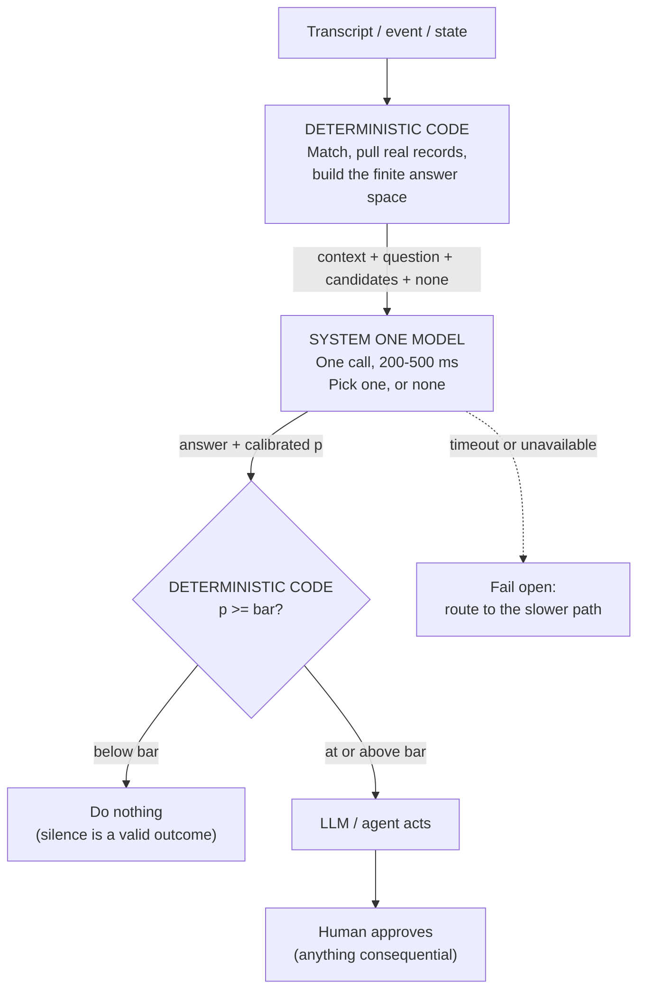

# System One Decisions

> **One-line intent:** Route narrow, high-frequency judgment calls to a constrained decision model that can only pick from a list your code built, and returns a calibrated probability your code can threshold, instead of spending an LLM call on them.

## Pattern in 60 Seconds

**The problem:** Agentic systems make a lot of small decisions. Was a person just named, and which one? Is this about an event? Is this a request or an aside? The reflex is to ask an LLM, because an LLM can answer anything. But these decisions happen constantly, a human is usually waiting on them, and a generative model can return something that isn't in your data at all.

**The insight:** Most of what an agentic system does all day isn't reasoning. It's a snap judgment from a short list, over and over. That class of decision doesn't need a model that can write; it needs a model that can **choose**, fast, from options you supply, and tell you how sure it is in a number you can act on.

| Step | Who does it | Why |
|------|-------------|-----|
| Assemble candidates | **Deterministic code** | The model never sees your whole database. It sees the handful of real records your code already matched. |
| Ask one typed question | **System One model** | Fixed answer space. It cannot return anything that isn't on the list. |
| Return a calibrated probability | **System One model** | Calibrated means 0.8 is right about 80% of the time, so the number is usable rather than decorative. |
| Apply the threshold | **Deterministic code** | Your risk tolerance is a number in code you can set, test and change, not a sentence in a prompt. |
| Fail open | **Deterministic code** | Past a hard time budget, fall through to the slower path. Never stop because a fast part is missing. |

**The core trade:** you give up the ability to answer anything, and you get back speed, cost, and a class of failure that is gone by construction.

**What broke when we got this wrong:** We asked one question that implicitly contained three ("is this about an event, and which of our three December events is it?"), and the model split its confidence across all three candidates so nothing cleared the bar. And we handed it a candidate list built by naive name matching, so when the operator addressed his own agent by name out loud, it confidently surfaced a stranger from the CRM who happened to share that name.

---

## Classification

| Property | Value |
|----------|-------|
| **Category** | Agentic Architecture |
| **Difficulty** | Intermediate |
| **Also Known As** | Constrained Decision Model, Typed Decision Gate, Pick-Don't-Generate, Fast-Path Classifier |
| **Related Patterns** | MCP Capability Envelope (the deterministic layer decisions flow into), Quality Gate Checkpoint (same instinct applied to output), Human Recovery Path (the top layer), Ladder of Trust (what the threshold is really expressing) |

---

## Motivation

A System One model is not a language model. You give it unstructured context, a question, and the complete set of answers it is permitted to give. It returns one of those answers and a probability. It cannot write prose, and it cannot name anything you didn't put in front of it.

That constraint is the point. In a generative system you prevent bad output by asking nicely and checking afterwards. Here the bad output has no representation: there is no token sequence the model can emit that corresponds to a person who isn't in the list. You are not reducing the probability of a hallucination; you are removing the mechanism.

The second property that matters is calibration. Any model can report confidence. A calibrated model's confidence means something across many answers, which is what lets a threshold live in code. "Show the card above 0.8" is a decision you can test against recorded traps, tune, and explain to a risk committee. "We instructed the model to be careful" is not.

In the build this pattern came from, a pair of smart glasses listens to a conversation and decides, on every speech pause, whether a person in the operator's CRM was just named. At that frequency, three properties decide the architecture: it has to answer in a fraction of a second, it has to cost almost nothing, and it absolutely cannot invent a person. A frontier model fails all three. The decision model answers in 200-500 ms for a rounding error, and the invention failure is structurally impossible.

The broader principle this expresses: **every decision should go to the cheapest layer that can make it correctly.** Not the smartest layer. Deterministic code where the answer is knowable, a System One model where it's a narrow judgment, an LLM where it genuinely needs reasoning, a human where it's consequential. Push work down whenever you can; go up only when the layer below actually can't do it. Get that wrong upward and you pay frontier prices to decide whether an email goes to finance. Get it wrong downward and you hard-code a rule that shatters the first time reality doesn't match it.

---

## Applicability

Four questions. Four yeses and you want a System One model rather than an LLM call.

1. **Is the answer one of a known, finite set?** Which of these five records. Yes or no. Which bucket. If you are producing prose, this is the wrong tool.
2. **Does it happen constantly?** If the decision fires twice a day, use your LLM; the savings aren't the point and the extra component isn't worth it.
3. **Does latency show?** If a human is waiting, the difference between half a second and three seconds is the whole product.
4. **Would a confident wrong answer cost you?** If yes, you want the wrong answer to be impossible rather than unlikely.

**Do NOT use this pattern when:**

- The task requires reasoning, generation, multi-step planning, or an open-ended output space.
- The candidate list cannot be built reliably by deterministic code. The model is only as good as the list, and a bad list produces a confident wrong answer (see What Broke).
- The decision is consequential on its own. This pattern decides whether to *surface* something; a human or an explicit approval step should decide whether to *act* on it.
- You cannot verify the model's calibration. Without calibration the probability is decoration and the threshold is theatre.

This pattern sits *underneath* your LLM, not instead of it.

---

## Structure



_The deterministic layers bracket the model on both sides: code decides what it may choose from, and code decides what its answer is worth. Each layer only does what it is cheapest at._

---

## Participants

| Participant | Role | Example |
|------------|------|---------|
| **Candidate builder** | Deterministic code that turns raw input into a short list of real records. The load-bearing step. | Scans a transcript for name-shaped tokens, queries the CRM, returns up to five real contacts |
| **System One model** | Answers one typed question from the supplied list, with a calibrated probability. Cannot generate. | TypeSafe Jev: context + question + fixed answer space in, one answer plus `p` out |
| **Threshold gate** | Deterministic code comparing `p` to a bar set from recorded evidence. Owns the risk tolerance. | `if (p >= 0.80) showCard()` — a number in version control |
| **Fallback path** | What runs when the fast path times out or is unavailable. | Hard 800 ms budget, then route the question to the LLM agent instead |
| **Actor** | The LLM or agent that does something once the decision says to. | Lou (AIOS main agent): looks up, drafts, books |
| **Approver** | The human, for anything consequential. | Operator long-presses to send the calendar invite |

---

## How It Works

1. **Build the candidate list in code.** This is the load-bearing step, and it is where this pattern actually fails in practice. The model's output can only be as good as the list. Naive matching produces bad lists.
2. **Ask one question per decision, not one question containing several.** A compound question splits confidence across candidates and nothing clears the bar. Ask "is this about an event at all," then "which one."
3. **Always include an explicit "none."** Silence must be a first-class answer, not the absence of one.
4. **Set the threshold from traps, not from hits.** Record real positives and realistic near-misses. Set the bar just above the highest trap rather than just below the lowest hit, because production conditions score lower than your desk does.
5. **Budget the call and fail open.** Hard timeout, and on expiry fall through to the slower path. The system should degrade, never stop.
6. **Log every decision with its score.** This is what lets you move the bar later with evidence instead of instinct, and it's the only way you'll notice the bar is in the wrong place.

### Code / Configuration Example

```ts
// Step 1 — deterministic: the model never sees the whole CRM.
const candidates = await crm.matchNames(extractNameTokens(transcript), { limit: 5 });
if (candidates.length === 0) return;            // nothing to decide

// Step 2 — one typed question, fixed answer space, explicit "none".
const decision = await jev.decide({
  context: transcript,
  question: "Which of these people, if any, was just named by the speaker?",
  answers: [...candidates.map(c => c.id), "none"],
  timeoutMs: 800,                                // step 5
}).catch(() => null);                            // fail open

if (!decision) return askTheAgentInstead(transcript);

// Step 3 — deterministic: the bar is a number in version control, not a prompt.
const BAR = 0.80;                                // set from recorded traps, step 4
log.decision({ answer: decision.answer, p: decision.p, bar: BAR });  // step 6

if (decision.answer !== "none" && decision.p >= BAR) {
  showCard(candidates.find(c => c.id === decision.answer));
}
// else: silence, which is a valid outcome
```

---

## Consequences

### Benefits

- An entire class of failure is removed by construction rather than mitigated.
- Fast enough and cheap enough to ask constantly, which enables ambient and always-on designs that would be unaffordable otherwise.
- The risk threshold becomes a tested number in code rather than an instruction in a prompt, which is a very different conversation with a risk function.
- Your expensive model is reserved for work that actually needs reasoning.
- Every decision carries a score, so the system is auditable in a way prompt-based judgment is not.

### Liabilities

- **A bad candidate list produces a confident wrong answer.** The constraint protects you from invention, not from error.
- One more component, one more dependency, one more failure mode to budget for.
- Calibration is a property of the model. Verify it rather than assuming it.
- Compound questions fail quietly, by splitting confidence rather than by erroring.
- The question set is now part of your architecture. Anything you didn't think to ask cannot be detected, only mis-answered.

### What Broke in Practice

_This section is mandatory. No pattern is accepted without honest failure modes._

**Confidence split across near-identical candidates.** Asked "is this about one of our upcoming events," with three events three days apart in December as candidates. The model distributed its confidence across all three and nothing cleared the bar, so a correct signal produced silence. The fix was to decompose: ask whether it's about an event at all, then which one. **A compound question looks like one decision and behaves like several.**

**The candidate list was the vulnerability, not the model.** On 2026-10-11 the operator said, out loud, with ambient listening running: *"Lou, what was the first thing you said to me?"* He was addressing his own agent. Code matched "Lou" against the CRM, found a real contact named Lou, and handed the model a one-item list. The model did exactly what it was built to do: it picked the only real option, scored it 0.79, and put a stranger's contact card on the display. It never answered the question, because nothing in that call asked *"is the speaker addressing the system?"*

Two lessons, and the second is the important one. First, an agent's own name inside its own data is a collision waiting to happen; exclude system identities from candidate matching. Second, and more general: **a constrained output space buys you no hallucination. It does not buy you comprehension.** The model will pick confidently from whatever list your code hands it. If the list is wrong, the answer is confidently wrong. Direct address had no representation in the question set, so it could not be detected, only mis-answered.

**The bar was not where we thought it was.** The 0.79 above was shown. A later utterance scored 0.66 and was not. The deployed threshold was not the number we had been describing in our own documentation. Log the scores and read the logs, or you will describe a method you aren't running.

---

## Implementation Notes

### Variations

- **Binary gate before the specific question.** Two cheap calls ("is this about an event?" then "which one?") beat one compound call, and the first can short-circuit the second.
- **Tiered thresholds by consequence.** A card that appears on a display can sit at 0.75; a decision that triggers an outbound message should sit far higher, or route to a human regardless of score.
- **Shadow mode.** Run the model and log its decisions without acting on them for a week before you let it drive anything. The log is how you set the bar.
- **A local classifier instead.** A small fine-tuned model or even a well-tested heuristic can occupy this layer. The pattern is the bracketing, not the vendor.

### Common Pitfalls

- **Setting the bar from your own test utterances.** Your desk is quiet. Production is not. Scores come in lower than you expect.
- **Treating silence as failure.** Most of the time the correct output is nothing. If your dashboards count "no decision" as a miss, you will tune the bar down until the system is noisy.
- **Letting the candidate builder grow into a second model.** When the matching logic starts needing judgment, that's a signal to add a decision call, not heuristics.
- **Forgetting system identities.** Your own agents' names, your product names, and your company name all live in your data and all get said out loud near the microphone.
- **Assuming calibration transfers.** Calibration measured on one question shape doesn't guarantee calibration on another.

---

## Security Implications

### Attack Surface

- **The candidate list is the injection point.** Anyone who can influence what your deterministic matcher pulls can steer the decision, because the model will only ever pick from that list. Input that shapes candidate selection deserves the scrutiny you'd give a query parameter.
- The model itself is a narrow surface by design: it cannot emit arbitrary text, so prompt-injection aiming at *output* has nothing to work with. Injection aiming at *selection* still does.
- The threshold is a security control. If it lives anywhere mutable at runtime, treat changing it as a privileged operation.

### Data Sensitivity

- The context you send is often raw and unfiltered (a live transcript, an inbox snippet), and the candidates are real records about real people. Both leave your boundary on every call. Decide deliberately whether that is acceptable for a third-party endpoint, and minimize the context to what the question needs.
- Decision logs contain who was identified, when, and how confidently. That log is a behavioral record about third parties; protect and retain it accordingly.
- In the originating implementation, surfacing a card means displaying one person's record because a *different* person said their name. The subject of the data is not the person who triggered the lookup and has not consented to the lookup.

### Failure Modes

- **Confidently wrong from a bad list** — the dominant failure. Nothing in the model layer can catch it.
- **Silent degradation** — if the fallback path is never exercised, you may not notice the fast path has been failing open for weeks.
- **Threshold drift** — documented bar and deployed bar diverge, and nobody knows which one is running (this happened to us).
- **Unavailability** — a hard dependency on an external endpoint in a user-facing hot path.

### Mitigations

- Exclude system and agent identities from candidate matching, and maintain that exclusion list as code.
- Hard timeout with fail-open to the slower path; alert on fallback rate, not just on errors.
- Log every decision with its score and the deployed bar, and reconcile the deployed bar against documentation on a schedule.
- Keep the consequential step behind an explicit human gesture, so a confidently wrong decision costs a glance rather than an action.
- Minimize context sent off-box; send the question's working set, not the whole transcript, where the question allows it.

---

## Known Uses

| Organization | Context | Scale |
|-------------|---------|-------|
| Cloud Nirvana | Ambient listening on Even Realities G2 glasses: person, event and meet-up detection on every speech pause, feeding an AIOS agent. Deterministic candidate assembly from the CRM, one typed decision call, threshold in code, human long-press for anything outbound. | 1 decision per utterance, continuous |

---

## Related Patterns

| Pattern | Relationship |
|---------|-------------|
| MCP Capability Envelope | The deterministic layer this pattern's decisions flow into; the model decides, a named script acts |
| Quality Gate Checkpoint | A deterministic check an agent cannot skip; same instinct, applied to output rather than decisions |
| Human Recovery Path | What the top layer is for: the human approves anything consequential, and the threshold decides what reaches them |
| Ladder of Trust | The threshold is a trust tier expressed as a number; raising the bar is the same move as demoting an agent |
| Hub-and-Spoke Agent Orchestration | This pattern sits below the hub, filtering what is worth waking the hub for |

---

## Metadata

| Property | Value |
|----------|-------|
| **Contributor** | Sean Erikson & Jonathan Erikson, Cloud Nirvana |
| **Production Environment** | Cloud Nirvana AIOS · Even Realities G2 · TypeSafe Jev · OpenClaw gateway |
| **First Published** | 2026-10-15 |
| **Last Updated** | 2026-10-15 |
| **Cloud Nirvana Event** | OHIOXR 2026 — "Lou on Glass" |
| **License** | CC BY 4.0 |
| **Status** | Published (the direct-address gap is open; see What Broke) |

---

## Revision History

| Date | Change | Author |
|------|--------|--------|
| 2026-10-15 | Initial pattern from the Lou on Glass build. What Broke from the December-events confidence split, the 2026-10-11 agent-name collision, and the threshold discrepancy found in the ambient logs | Sean Erikson / Claude Code |
